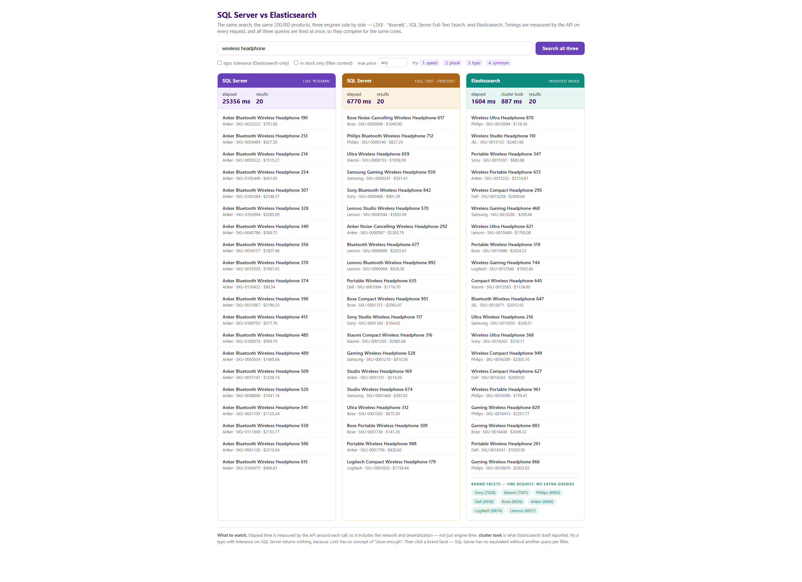
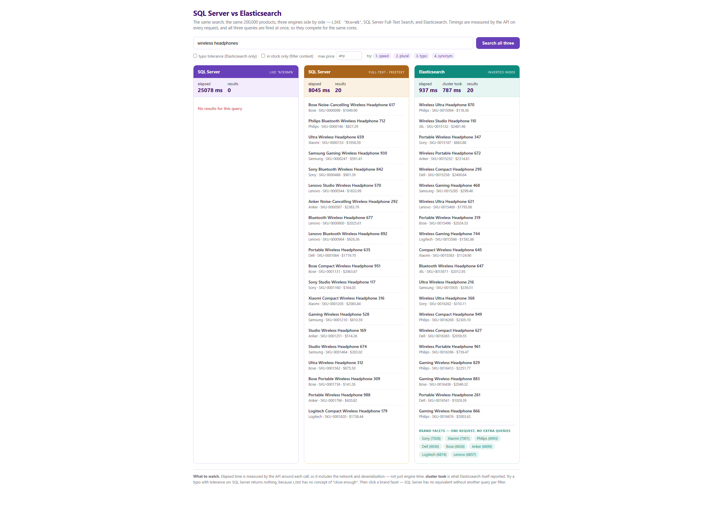
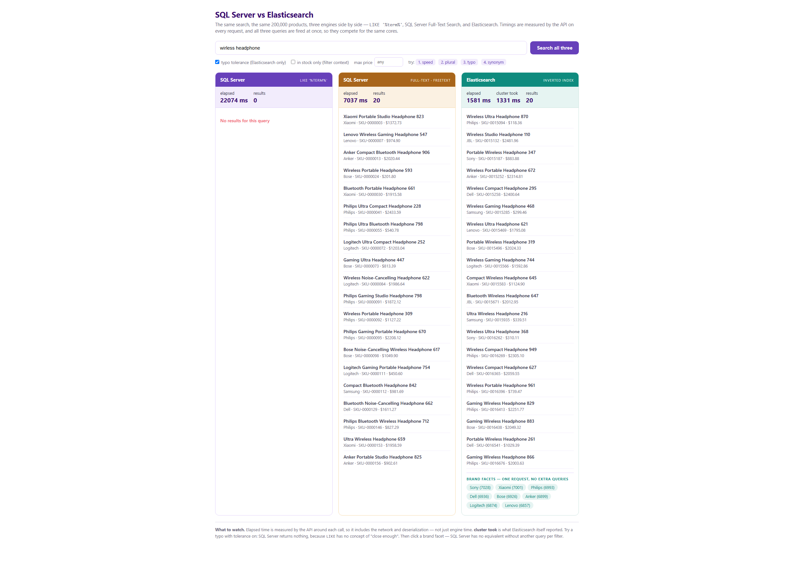
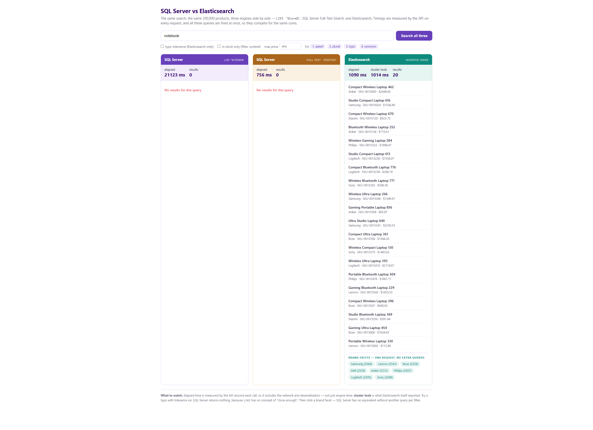
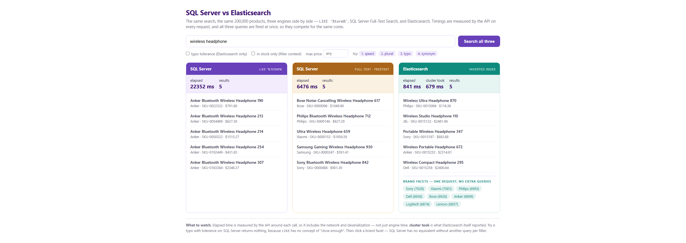

# High-Performance Search APIs in .NET 10 with Elasticsearch

Companion to the article: **[Building High-Performance Search APIs in .NET 10 Using Elasticsearch](https://medium.com/@msshaikh-simform/41f654941346)**

A runnable proof of concept that puts **three search engines side by side** over the same 200,000-product
catalog — same data, same machine, same queries — and measures the difference:

| | |
| --- | --- |
| **SQL Server `LIKE '%term%'`** | the baseline almost every catalog starts with |
| **SQL Server Full-Text Search** | the strongest option *inside* the database |
| **Elasticsearch** | the purpose-built search engine |

> **Headline:** at 20 concurrent users, `LIKE` p50 is **126,779 ms**, full-text is **10,945 ms**, Elasticsearch
> is **195 ms**. More telling: `LIKE` and full-text serve a flat 0.1–3.0 req/s no matter how many users arrive,
> while Elasticsearch climbs from 25 to 85.
> Full method and numbers: [docs/benchmark-results.md](docs/benchmark-results.md)

The comparison includes full-text search on purpose. Comparing Elasticsearch only against `LIKE` is the easiest
objection to raise against a post like this, so the stronger SQL option is measured rather than argued about.

Every response carries its own timing, so the difference is visible in the payload itself — no profiler needed.

```jsonc
// GET /api/search?q=wireless headphone&size=2
{
  "engine": "elasticsearch",
  "query": "wireless headphone",
  "count": 2,
  "page": 1, "size": 2, "hasMore": true,
  "elapsedMs": 46,          // measured by the API (includes network + deserialization)
  "tookMs": 34,             // reported by the cluster itself
  "items": [
    { "id": 7166, "sku": "SKU-0007166", "name": "Wireless Portable Headphone 898",
      "brand": "Sony",    "price": 1091.61 },
    { "id": 7462, "sku": "SKU-0007462", "name": "Ultra Wireless Headphone 419",
      "brand": "Samsung", "price": 612.71 }
  ],
  "facets": { "Sony": 7028, "Xiaomi": 7001, "Philips": 6993 }   // same request, no extra queries
}
```



---

## What is Elasticsearch?

A distributed search and analytics engine built on Apache Lucene, maintained by Elastic N.V. (first released
2010). Instead of scanning rows for matching text, it stores an **inverted index** — a map of each term to the
documents containing it — so lookup cost tracks how many documents *match*, not how many *exist*.

**Why it matters here:** a `LIKE '%term%'` has a leading wildcard, so no B-tree index can be used and every row
gets read. That cost grows with your table. An inverted index does not work that way.

### Features this POC actually demonstrates

| Feature | Where |
| --- | --- |
| Inverted index + full-text search | `/api/search` |
| Analyzers: stemming, ASCII folding, synonyms | `ProductIndex.cs` |
| Multi-fields (one value, several jobs) | `name`, `name.keyword`, `name.suggest`, `brand`, `brand.text` |
| Relevance scoring (BM25) + field boosts | `name^3, brand.text^2, description` |
| Filter context vs query context | `filter` clauses for brand, price and stock |
| Aggregations for facet counts | `by_brand`, `by_category` — same request |
| Typo tolerance (fuzziness) | `?fuzzy=true` |
| Autocomplete (`search_as_you_type`) | `/api/suggest` |
| Bulk indexing with per-item error checks | `ProductSearch.Seeder` |
| Index alias for zero-downtime reindexing | `products` → `products-v2` |
| **Zero-downtime reindex + atomic alias swap** | `--reindex`, see [Case 10](#case-10--zero-downtime-reindexing) |

### What .NET 10 brings to this

| Feature | Where you see it |
| --- | --- |
| **Minimal API validation** | `ProductSearchRequest` carries `[Required]`, `[Range]`, `[StringLength]`. An invalid request never reaches the handler — `?size=999` comes back as a 400 naming the field. Covered by a test. |
| **OpenAPI 3.1** (3.0 previously) | `GET /openapi/v1.json` reports `"openapi": "3.1.1"`, with `TypedResults` and `ProducesProblem` so success *and* error shapes are documented |
| **XML comments in OpenAPI** | Endpoint summaries come from `///` comments in the source |
| **`Microsoft.Extensions.Validation`** | Ships in the shared framework, so no package reference is needed |

### Not covered here

Outbox/CDC syncing, `search_after` deep pagination, caching, resilience policies, multi-tenancy,
OpenTelemetry, vector/hybrid search. They are real production concerns, but each one would pull attention away
from the question this POC exists to answer: how far do `LIKE` and full-text search get you, and where do they
stop?

---

## Prerequisites

- **.NET 10 SDK**
- **Docker Desktop**, at least **5 GB** allocated (Settings → Resources)
- ~4 GB disk for images, ~600 MB for data

Commands below are shown for **PowerShell**, the Windows default. They work unchanged in bash except where
noted (`curl.exe` becomes `curl`).

## Quick start

```powershell
git clone https://github.com/msshaikh-simform/dotnet10-elasticsearch-search-api.git
cd dotnet10-elasticsearch-search-api

docker compose up -d --build                                         # 1. Elasticsearch 9.5.3 + SQL Server 2022
dotnet run --project src/ProductSearch.Seeder -c Release -- 200000   # 2. seed + index (3-5 min)
dotnet run --project src/ProductSearch.Api    -c Release             # 3. API + demo UI
```

Open **<http://localhost:5080>**.

> ⚠️ **Step 1 builds an image, so the first run takes a few minutes.** The stock SQL Server image does not
> include Full-Text Search — `SERVERPROPERTY('IsFullTextInstalled')` returns 0 — so
> [`docker/sqlserver/Dockerfile`](docker/sqlserver/Dockerfile) installs `mssql-server-fts` on top of it.
> Docker caches the result; later runs are instant. Without it, the `LIKE` and Elasticsearch engines still work
> and `/api/search/sqlfts` returns a 503 explaining what to do.

> ⚠️ **Step 2 is required and is not automatic.** The API does not seed on startup. Skip it and every engine
> returns zero results. Most of the time is the SQL Server full-text index populating, which the seeder waits
> for — benchmarking a half-populated index would quietly flatter `LIKE`.

### Behind a TLS-intercepting proxy?

If your network inspects TLS (Zscaler and similar), the image build fails with
*"Certificate verification failed: The certificate issuer is unknown"* because the container cannot verify
`packages.microsoft.com`. Drop your corporate root CA into `docker/sqlserver/certs/` and build with:

```powershell
docker compose build --build-arg EXTRA_CA_CERT=your-ca.crt
```

That directory is gitignored. On an ordinary network you need none of this.

### Verify before you start

Elasticsearch takes ~60s to come up. Most "cannot connect" problems are just that:

```powershell
curl.exe -u elastic:changeme http://localhost:9200/_cluster/health
```

```bash
curl -u elastic:changeme http://localhost:9200/_cluster/health
```

> In Windows PowerShell 5.1 (the default blue-icon shell), `curl` is an alias for `Invoke-WebRequest`, which
> has no `-u` flag and fails with *"parameter name 'u' is ambiguous"*. Writing `curl.exe` calls the real curl
> that ships with Windows 10+ and works in both PowerShell 5.1 and 7.

A response containing `"status":"green"` or `"status":"yellow"` means you're ready.

### Expected output at each step

| Step | You should see |
| --- | --- |
| `docker compose up -d --build` | 2 containers: `ps-elasticsearch`, `ps-sqlserver` |
| Seeder | `SQL Server loaded in …`, `full-text index built in …`, `Elasticsearch indexed in … (0 failures)` |
| Index check | `products-v2` — 200,000 docs, ~105 MB |
| API | Listening on `http://localhost:5080` |

---

## The test cases

Open **<http://localhost:5080>**. Each numbered chip under the search box runs one case.

**Where to look:** the big number under **`elapsed`** on each panel — purple is `LIKE`, amber is full-text,
teal is Elasticsearch — and the **`results`** count beside it. Elasticsearch also reports **`cluster took`**,
its own measurement excluding network and deserialization.

> **Read this before judging the numbers.** The page fires all three queries *simultaneously*, so the `LIKE`
> scan saturates every core while the other two are answering. That inflates their `elapsed` — compare
> `cluster took` for Elasticsearch's real cost, or run the benchmark, which tests each engine separately.

---

### Case 1 — Speed, with nothing else different

**Click `1. speed`** (searches `wireless headphone`)


| | `LIKE` | Full-Text | Elasticsearch |
| --- | --- | --- | --- |
| Results | 20 | 20 | 20 |
| Benchmarked p50 | ~5,600 ms | ~380 ms | **~39 ms** |

**All three return 20 results.** Nothing is different except how they found them, which makes this the clean
speed comparison — nobody can dismiss it as "you compared a working query to a failing one."

**Why `LIKE` is slow.** The leading wildcard means no index can be used — the engine has no way to know where
inside the text a match begins, so every row is read. Its cost is proportional to **rows stored**.

**Why the other two are fast.** Both consult an index built at write time and touch only the entries for the
terms in the query. Their cost is proportional to **rows matched**.

**Now look at the result lists.** `LIKE` returns twenty consecutive *Anker* products, because `ORDER BY Name`
is alphabetical and "Anker" sorts first. Full-text orders by `RANK`; Elasticsearch orders by BM25 relevance.
A real user would look at the `LIKE` column and conclude the search is broken. **`LIKE` has no concept of a
"best" match.**

---

### Case 2 — Plurals (stemming)

**Click `2. plural`** (searches `wireless headphone`**s**)



| | `LIKE` | Full-Text | Elasticsearch |
| --- | --- | --- | --- |
| Results | **0** | 20 | 20 |

The products are named "Headphone". You typed "headphone**s**". `LIKE` scanned all 200,000 rows and **found
nothing** — no amount of tuning fixes it, because `LIKE` has no concept of word forms.

**This is the case full-text search wins.** `FREETEXT` matches inflectional forms, so it finds them, exactly as
Elasticsearch does by stemming both sides to `headphon`. If plurals are the only gap you have, full-text search
may be all you need — and it needs no new infrastructure.

---

### Case 3 — Typos

**Click `3. typo`** (searches `wirless headphone`, typo tolerance on)



| | `LIKE` | Full-Text | Elasticsearch |
| --- | --- | --- | --- |
| Results | **0** | 20 * | 20 |

One transposed letter. Elasticsearch matches within an edit distance scaled to word length.

> **\* Full-text does not actually tolerate the typo.** `FREETEXT` treats its terms as OR, so this query
> returns results purely because "headphone" matches. Search for `wirless` on its own and full-text returns
> **0**, same as `LIKE`. There is no edit distance in SQL Server full-text search.

> **Why this example and not `wireles`.** An earlier version used `wireles`, and `LIKE` returned 20 results —
> because "wireles" is a *substring* of "Wireless", so `LIKE '%wireles%'` matched by coincidence. That proved
> nothing. `wirless` is a genuine misspelling that is not a substring of anything in the data.

Note the checkbox: fuzziness is **opt-in**, because it costs more and must never be applied to identifiers.
One character separates `SKU-0015030` from `SKU-0015031`.

---

### Case 4 — Synonyms

**Click `4. synonym`** (searches `notebook`)



| | `LIKE` | Full-Text | Elasticsearch |
| --- | --- | --- | --- |
| Results | **0** | **0** | 20 — all **Laptop** products |

**The word "notebook" appears nowhere in the data.** Elasticsearch returns laptops because the analyzer expands
`notebook` to `laptop` at search time, and because the expansion happens at *search* time the synonym list can
change without reindexing 200,000 documents.

**Full-text search returns nothing here.** SQL Server does support a thesaurus, but it ships empty — it needs
an XML file per language and a reload before `FORMSOF(THESAURUS, …)` does anything at all.

> **Why this example and not `television`.** Products are literally *named* "Television", so every engine
> matches directly and the `tv, television` synonym is never exercised. `notebook` has no literal match, so
> only the synonym can find it.

---

### Case 5 — Facets, free with the search

**Set the result count low and look at the Elasticsearch panel:** <http://localhost:5080/?q=wireless+headphone&size=5>



The counts — `Sony (7028)`, `Xiaomi (7001)` — arrived **in the same request as the results**. Clicking one
filters instantly.

Neither SQL engine has an equivalent. Each of those eight counts would be a separate `GROUP BY` over the same
data: eight more passes to render one sidebar.

---

### Case 6 — Autocomplete

**Type `sony wire` slowly in the search box**

Suggestions appear as you type, from a `search_as_you_type` field, fast enough to fire on every keystroke.
There is no practical SQL equivalent at 200,000 rows on every keystroke.

---

### Case 7 — Brand matching across fields

Three names in five lead with the brand; the rest do not. Try
<http://localhost:5080/?q=sony+battery+headphone>.

That one query matches a **brand** (`brand.text`), a **feature** (`description`) and a **product type**
(`name`) in three different fields, and blends them into a single relevance score.

```
8,036 Sony products whose name does not contain "Sony"
```

Those are findable *only* through the brand field. This is also the case to try with `?brand=sony` — the filter
is case-insensitive, so lowercase works.

> **This used to be broken, silently.** `brand` was mapped as a bare `keyword`, and in a `multi_match` a
> keyword field only matches when the *whole* query string equals the stored value. `brand^2` matched **0**
> documents for `sony wireless headphones`, and `?brand=sony` returned nothing while `?brand=Sony` worked.
> The fix is the `brand.text` sub-field plus `CaseInsensitive = true` on the term filter. No error was ever
> raised — the boost simply did nothing.

---

### Case 8 — Where SQL Server wins

Open **<http://localhost:5080/api/lookup/sql?sku=SKU-0100000>**

| Engine | p50 | Throughput |
| --- | --- | --- |
| **SQL Server** | **4 ms** | **221.5 req/s** |
| Elasticsearch (`term` on `sku`) | 12 ms | 62.6 req/s |

An indexed column and an exact value: the database is **about 3× faster**. This case is in the POC
deliberately. Elasticsearch is not a database replacement — it is a read model for the queries a database is
bad at, and a comparison that only ever favours one side isn't worth trusting.

---

### Case 9 — Under load, which is where it actually matters

Single searches are survivable for one user. Real applications have many.

**Stop the API first** (Ctrl+C) so it doesn't compete for CPU, then:

```powershell
dotnet run --project src/ProductSearch.Benchmark -c Release -- --requests 40
```

Takes about 10 minutes and will fully load your CPU. Results in
[docs/benchmark-results.md](docs/benchmark-results.md).

---

### Case 10 — Zero-downtime reindexing

Some mapping changes cannot be applied in place. The usual answer is "build a new index and swap the alias",
which is easy to describe and rarely shown. Run it:

```powershell
dotnet run --project src/ProductSearch.Seeder -c Release -- --reindex products-v3
```

It creates `products-v3` with the current mapping, copies every document across, then moves the `products`
alias in a single atomic `UpdateAliases` call. **Searches keep working throughout** — the API never learns the
index name, because it only ever queries the alias. The old index stays in place for an immediate rollback.

---

## Results

See [docs/benchmark-results.md](docs/benchmark-results.md) for the full tables, the repeatability spread
between runs, and the measurement caveats.

| Concurrency | `LIKE` p50 | Full-Text p50 | Elasticsearch p50 | `LIKE` tput | Full-Text tput | ES tput |
| --- | --- | --- | --- | --- | --- | --- |
| 1 | 5,621 ms | 381 ms | **39 ms** | 0.2 req/s | 2.4 req/s | **25.3 req/s** |
| 5 | 24,074 ms | 1,225 ms | **57 ms** | 0.2 req/s | 3.0 req/s | **77.2 req/s** |
| 20 | 126,779 ms | 10,945 ms | **195 ms** | 0.1 req/s | 1.5 req/s | **85.5 req/s** |

**Throughput matters more than latency here.** `LIKE` and full-text both have a fixed ceiling they hit
immediately; only Elasticsearch answers more requests as more users arrive.

Measured on an i5-1135G7 (4c/8t), 16 GB RAM, everything on one laptop. Absolute numbers are indicative — but
all three engines faced identical data and conditions.

---

## Endpoints

| Endpoint | Purpose |
| --- | --- |
| `GET /api/search?q=&brand=&maxPrice=&inStock=&fuzzy=&page=&size=` | **Primary.** Elasticsearch with filters, facets and paging |
| `GET /api/search/sql?q=&page=&size=` | SQL Server `LIKE` baseline |
| `GET /api/search/sqlfts?q=&page=&size=` | SQL Server Full-Text Search baseline |
| `GET /api/suggest?q=` | Autocomplete (`search_as_you_type`) |
| `GET /api/products/{id}` | Product detail |
| `GET /api/lookup/sql?sku=` | Exact indexed lookup — the case SQL Server wins |
| `GET /api/health` | Per-dependency status, and whether data is seeded |
| `GET /openapi/v1.json` | OpenAPI 3.1 document |

Deep links work: `http://localhost:5080/?q=wireless+headphone&fuzzy=1&brand=Sony&size=5`

## Project layout

```
docker-compose.yml                        Elasticsearch 9.5.3 + SQL Server 2022 (built, not pulled)
docker/sqlserver/Dockerfile               SQL Server + Full-Text Search
src/ProductSearch.Core/
  ProductIndex.cs                         mapping, analyzers, alias, reindex  <- start here
  SearchServices.cs                       all three engines, side by side
  Catalog.cs                              models, request and response contracts
  Diagnostics.cs                          dependency checks and hints
  Env.cs                                  connection settings with dev defaults
src/ProductSearch.Api/
  Program.cs                              client registration, endpoints, error handling
  wwwroot/index.html                      demo UI
src/ProductSearch.Seeder/                 200k products -> SQL -> full-text index -> bulk index
src/ProductSearch.Benchmark/              p50/p95/p99 + throughput, three engines
tests/ProductSearch.Tests/                integration tests for the claims above
docs/benchmark-results.md                 full results and method
```

**Read `ProductIndex.cs` first.** Index design decides more about search quality and speed than any query.

## Tests

```powershell
dotnet test
```

Seven tests, each protecting a specific claim in the article:

| Test | Protects |
| --- | --- |
| `size=999` → 400 | The validation response the article shows |
| missing `q` → 400 | The `[Required]` message |
| `page=501` → 400 | The explained result-window error |
| `page=500&size=20` → 200 | **Used to be a raw 500.** The look-ahead hit pushed `from + size` one past the window |
| `?brand=sony\|Sony\|SONY` → hits | **Used to return nothing for lowercase.** The term filter was case-sensitive |

They need the stack running and the catalog seeded; when it isn't, they skip with the command to run rather
than failing.

---

## Configuration

**Nothing needs configuring to run it.** Every setting has a local-development default, defined in one place:
[`src/ProductSearch.Core/Env.cs`](src/ProductSearch.Core/Env.cs).

| Variable | Default |
| --- | --- |
| `ELASTICSEARCH_URL` | `http://localhost:9200` |
| `ELASTICSEARCH_USERNAME` | `elastic` |
| `ELASTIC_PASSWORD` | `changeme` |
| `SQLSERVER_HOST` | `localhost,1433` |
| `SQLSERVER_USER` | `sa` |
| `MSSQL_SA_PASSWORD` | `Str0ng!Passw0rd` |
| `SQLSERVER_CONNECTION` | built from the above — set it to replace the whole string |
| `Elasticsearch:ApiKey` | none locally; **required outside Development** |

The same two password variables are read by `docker-compose.yml`, so copying `.env.example` to `.env` and
editing it changes both the containers and the apps at once (`.env` is gitignored).

> These are throwaway credentials for containers that only listen on localhost. **Outside Development the API
> refuses to start without `Elasticsearch:ApiKey`** rather than quietly connecting as the built-in superuser —
> a misconfigured deployment should fail at startup, not run on `elastic`/`changeme`.

Seed a smaller catalog if your machine is tight:

```bash
dotnet run --project src/ProductSearch.Seeder -c Release -- 50000
```

### Reset or clean up

```bash
docker compose down          # stop containers, keep data
docker compose down -v       # stop and delete all data (start completely fresh)
```

## When something goes wrong

The most confusing failure in a project like this is the silent one: everything is running, nothing is seeded,
and every search returns zero with no explanation. So the POC checks its own dependencies and tells you.

**At startup**, before the first request:

```
  Startup check
  ─────────────────────────────────────────────────────────────
   [ OK ]  Elasticsearch    reachable at http://localhost:9200
   [FAIL]  Product index    index/alias 'products' does not exist
           -> Run the seeder: dotnet run --project src/ProductSearch.Seeder -c Release -- 200000
   [ OK ]  SQL Server       reachable, Products table present
  ─────────────────────────────────────────────────────────────
  The API will start, but searches return nothing until you seed.
```

**In the seeder**, both engines are checked *before* 200,000 products are generated, so a stopped container is
reported in a second rather than after a minute of wasted work. Exit codes: `0` success, `1` dependencies
unavailable, `2` seeded but some documents failed to index.

**In the API**, every failure is a `ProblemDetails` response with a fix, not a stack trace — and every failure
is logged server-side with a `traceId` the caller can quote. Unexpected errors return a generic detail rather
than raw internal text.

**In the browser**, the page checks `/api/health` on load and shows what to run:


| Situation | Status | What you are told |
| --- | --- | --- |
| No `q` supplied | 400 | Which field is missing, and an example |
| `size=999` | 400 | `size must be between 1 and 100` |
| Page beyond 10,000 results | 400 | The `max_result_window` limit, and that deep paging needs `search_after` |
| Index missing / not seeded | 503 | The exact seeder command |
| Elasticsearch not started | 503 | That it needs ~60s, and `docker compose up -d` |
| Full-text not installed | 503 | To rebuild the image with `docker compose up -d --build` |
| SQL Server not ready | 503 | That it starts more slowly than Elasticsearch |
| SQL timeout under load | 504 | That this is the expected finding, not a defect |
| Unknown product id | 404 | The valid id range |

## Troubleshooting

| Problem | Fix |
| --- | --- |
| `curl : parameter name 'u' is ambiguous` | You are in Windows PowerShell, where `curl` aliases to `Invoke-WebRequest`. Use `curl.exe`. |
| `Cannot connect to localhost:9200` | Elasticsearch needs ~60s. Poll `/_cluster/health`. |
| Elasticsearch container exits | Raise Docker memory to 5 GB+. |
| `Login failed for user 'sa'` | SQL Server starts slower than Elasticsearch. Wait, retry. |
| Image build fails on certificate verification | Your network intercepts TLS — see [Behind a TLS-intercepting proxy](#behind-a-tls-intercepting-proxy). |
| `/api/search/sqlfts` returns 503 | Full-text search is not installed. `docker compose up -d --build`, then re-seed. |
| SQL search times out | Expected above ~10 concurrent users. That is the finding, not a bug. |
| Build fails: "file is locked by ProductSearch.Api" | The Seeder and Benchmark reference `ProductSearch.Core`, not the API executable, so you can re-seed while the API runs. |
| Benchmark numbers look low | Stop the API first (Ctrl+C). If it is running it competes for the same CPU the benchmark is measuring. |
| All three "look fast" when clicking | A single search is survivable for one user. Run case 9; under 20 concurrent users `LIKE` passes two minutes. |
| Port 5080 in use | `dotnet run --project src/ProductSearch.Api -- --urls http://localhost:5090` |

## Development-only warnings

This setup is **not production-shaped**, deliberately:

- Single Elasticsearch node, **0 replicas** → no fault tolerance
- **TLS disabled** on the HTTP layer
- Passwords in `.env`
- `DisableDirectStreaming` and 1 shard are local-development choices

Production needs multiple nodes, a considered replica count, TLS, and secrets in a real secret store.

---

## Conclusion

- **Use a database** for exact lookups, ranges, joins and transactions. It wins those, by a lot.
- **SQL Server Full-Text Search is a real option.** It fixes plurals, uses an index, and ranks results. If that
  is the whole of your problem, it needs no new infrastructure and you should use it.
- **It stops at typos, synonyms and facets** — and its throughput is as flat as `LIKE`'s under load.
- **Use Elasticsearch** when search quality *is* the feature: ranking, typo tolerance, synonyms, facet counts
  in one round trip, and throughput that grows with your traffic.
- **Index design beats query tuning.** Field types, analyzers and multi-fields are chosen once and constrain
  everything after — and when they are wrong, they fail silently rather than loudly.
- Keep both. The database stays the source of truth; Elasticsearch is a specialised read model beside it.

## Versions

.NET 10 · Elasticsearch 9.5.3 · `Elastic.Clients.Elasticsearch` 9.5.3 · SQL Server 2022 + Full-Text Search ·
Bogus 35.6.5
